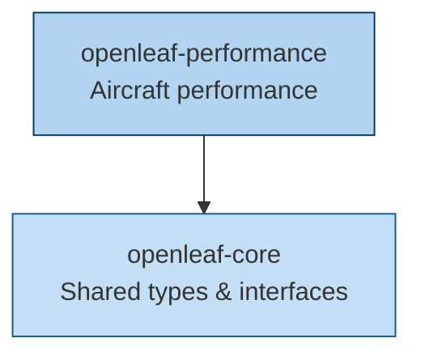

<p align="center">
  
</p>

<h1 align="center">OpenLeaf</h1>
<p align="center"><strong>Open-source aviation sustainability suite — performance modeling, emissions, and trajectory optimization.</strong></p>

<p align="center">
  <a href="https://github.com/eurocontrol-asu/openleaf/actions/workflows/ci.yml"></a>
  <a href="https://github.com/eurocontrol-asu/openleaf/actions/workflows/ci.yml"></a>
  
  <a href="https://eurocontrol-asu.github.io/openleaf/"></a>
</p>

---

## Philosophy

OpenLeaf provides **open-source tools for aviation sustainability research**. The suite is designed for researchers and aviation professionals who need accurate, reproducible, and differentiable aircraft performance models.

- **Modular Performance Models** — BADA 3/4, Poll-Schumann, OpenAP — all behind a unified interface with pluggable backends.
- **Multi-Backend Computation** — NumPy, JAX, CasADi, and PyTorch via the Array API standard. From quick analysis to GPU-accelerated optimization.
- **Emissions & Climate Impact** — Fuel burn, CO2, NOx, and contrail assessment integrated into the performance pipeline.
- **Differentiable by Design** — End-to-end differentiable models for trajectory optimization with automatic differentiation.

## Packages

| Package | Description | Quality |
|---|---|---|
| [openleaf-performance](packages/openleaf-performance/) | Modular, differentiable aircraft performance modeling framework | [](https://github.com/eurocontrol-asu/openleaf/actions/workflows/ci.yml) |
| [openleaf-core](packages/openleaf-core/) | Shared types and interfaces for the OpenLeaf suite | — |

## Quick Start

```bash
# Clone and install
git clone https://github.com/eurocontrol-asu/openleaf.git
cd openleaf
uv sync --all-groups

# Run all tests
make test-all

# Lint + type check
make check
```

## Architecture



## Development

| Command | Description |
|---|---|
| `make test-all` | Run tests for all packages |
| `make test-performance` | Run tests for openleaf-performance |
| `make test-core` | Run tests for openleaf-core |
| `make lint` | Ruff linter + formatter check |
| `make type-check` | Run mypy per package |
| `make check` | Lint + type-check + tests |
| `make docs-serve` | Preview documentation |

## License

[EUPL-1.2](LICENSE) — © 2026 EUROCONTROL
