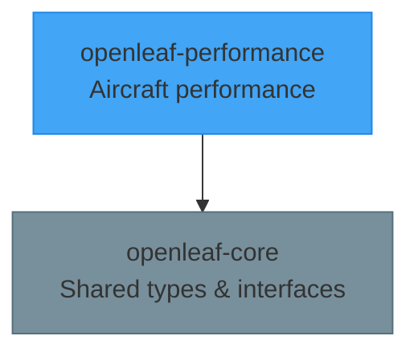

---
hide:
  - toc
---

# Packages

-   :material-airplane:{ .lg .middle } **openleaf-performance**

    ---

    A modular, differentiable aircraft performance modeling framework supporting BADA, Poll-Schumann, OpenAP and more.

    [:octicons-arrow-right-24: Getting Started](../performance/)

## Architecture

