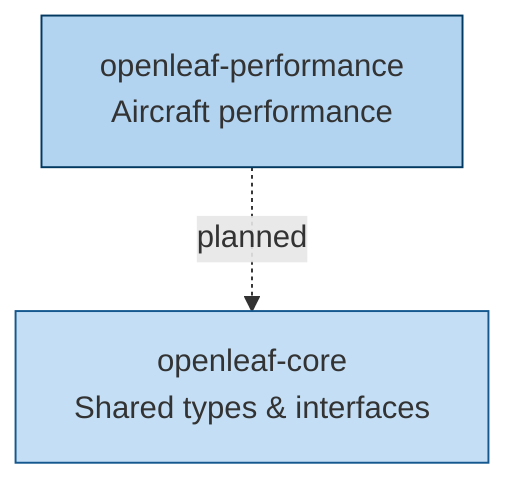

---
hide:
  - toc
---

# Packages

-   :material-airplane:{ .lg .middle } **openleaf-performance**

    ---

    Modular, differentiable aircraft performance modeling with BADA, Poll-Schumann, OpenAP and more.

    

    [:octicons-arrow-right-24: Getting Started](../openleaf-performance/)

-   :material-cube-outline:{ .lg .middle } **openleaf-core**

    ---

    Reserved for shared types, protocols, and interfaces for the OpenLeaf
    suite. Currently a placeholder package: `openleaf-performance` does not
    yet depend on it.

## Architecture

