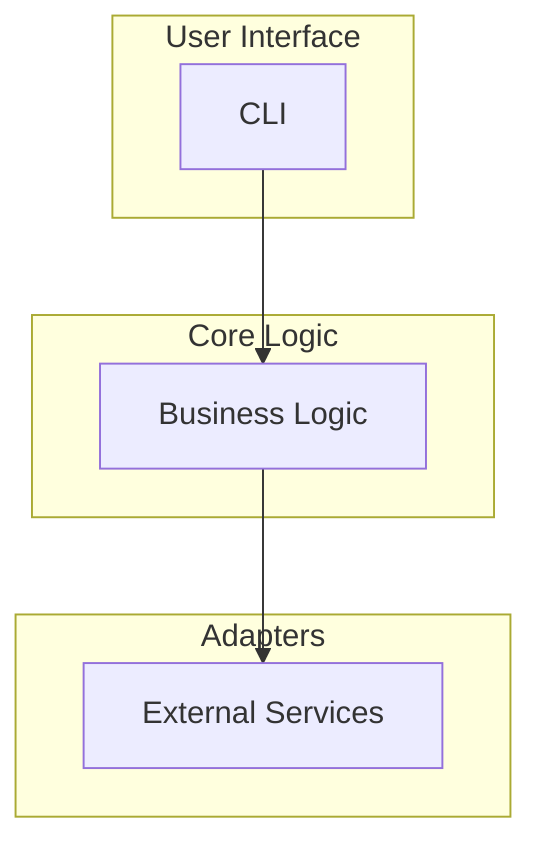

# Architecture

## Overview

`openleaf-performance` follows a layered architecture with clear separation of concerns:

## Layers

### 1. CLI

Entry point for user commands. Handles input validation and formatted output.

### 2. Core Logic (`core/`)

Business logic independent of I/O.

### 3. Adapters (`adapters/`)

Each adapter wraps a single external dependency for testability.

## Design Decisions

| Decision | Rationale |
|---|---|
| Hexagonal architecture | Testable core, swappable adapters |
| Pydantic models | Validation, serialization |
| `src/` layout | PEP 621 best practice, no import conflicts |
