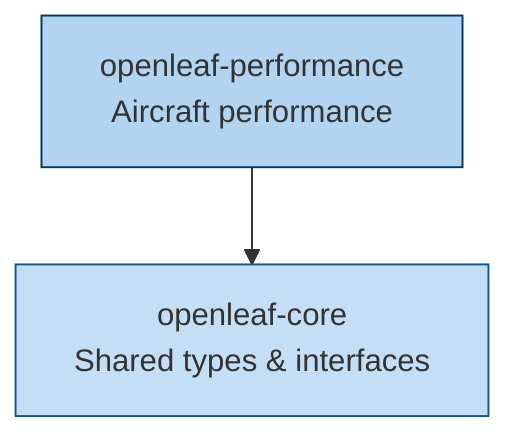

# openleaf-core

<p align="center">
  <strong>Shared types and interfaces for the OpenLeaf suite</strong>
</p>

<p align="center">
  <a href="https://github.com/eurocontrol-asu/openleaf/actions/workflows/ci.yml"></a>
  <a href="https://github.com/eurocontrol-asu/openleaf/actions/workflows/ci.yml"></a>
  
</p>

---

`openleaf-core` defines the common types, protocols, and interfaces shared across all OpenLeaf packages. It serves as the foundation that other packages (like `openleaf-performance`) build upon.

## Installation

```bash
uv add openleaf-core
```

## Role in the suite



All OpenLeaf packages depend on `openleaf-core` for shared definitions. If you are using `openleaf-performance`, `openleaf-core` is installed automatically as a dependency.
