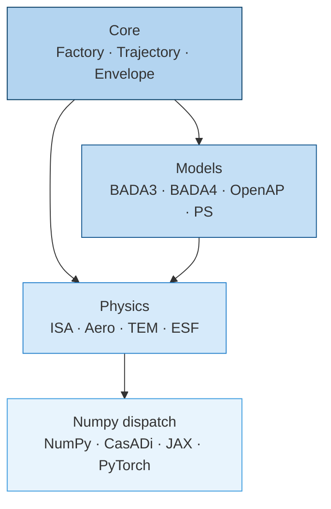
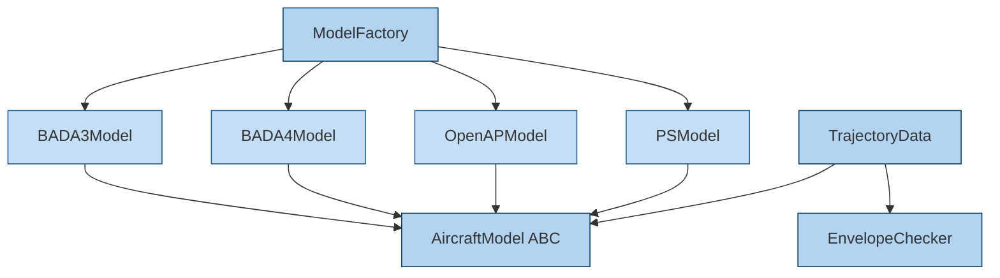
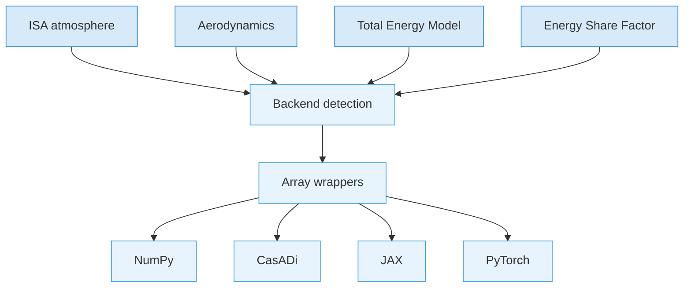

# Architecture

## Overview

`openleaf-performance` is organized in four layers. Each layer depends only on
the layers below it.

### Layer overview

### Core & Models

### Physics & Dispatch

## Layers

### Core (`core/`)

Defines the interfaces and containers that all model implementations share:

- **`AircraftModel`** -- abstract base class composed of three subsystems:
  `EngineModel` (thrust, fuel flow), `AerodynamicsModel` (drag coefficient),
  and `LimitsModel` (flight envelope). Every backend implements these.
- **`TrajectoryData`** -- lazy container for flight state arrays (altitude, TAS,
  vertical speed, mass). Automatically derives ISA properties, Mach, CAS, and
  energy share factor on first access. All properties are cached.
- **`AircraftTrajectoryData`** -- extends `TrajectoryData` with an attached
  aircraft model. Adds computed performance (drag, thrust, fuel flow) via
  `FlightStateMixin` and `PerformanceMixin`.
- **`EnvelopeChecker`** -- validates flight state against aircraft limits
  (overspeed, underspeed, ceiling, mass). Configurable modes: `IGNORE`,
  `WARN`, `RAISE`.
- **`ModelFactory`** -- unified entry point that loads any model by ICAO code.
  Tries model types in priority order (BADA4 > BADA3 > OpenAP > PS).

### Models (`models/`)

Four concrete implementations of `AircraftModel`:

| Backend | Data source | Parsing | Strengths |
|---|---|---|---|
| BADA3 | `.OPF` files (EUROCONTROL) | Regex extraction | Wide aircraft coverage, simple coefficients |
| BADA4 | XML files (EUROCONTROL) | ElementTree | High-fidelity polynomials, configuration-dependent |
| OpenAP | `openap` Python library | Library wrapper | Open data, no license required |
| PS | `pycontrails` library | Library wrapper | Contrail/climate research, Reynolds-based drag |

All backends share a common pattern:

1. **Pydantic schemas** -- frozen data classes for aircraft, engine, aero, limits
2. **Parsing** -- format-specific (regex, XML, library API)
3. **Synonym resolution** -- maps ICAO codes to data files
4. **Configuration selection** -- shared logic in `models/common/` determines
   aerodynamic configuration (cruise, climb, approach, landing) from altitude,
   speed, and flight phase

### Physics (`physics/`)

Domain modules used by models and trajectory calculations:

- **`isa`** -- International Standard Atmosphere (temperature, pressure, density
  from altitude). Provides `AtmosphericState` with cached properties.
- **`aero`** -- Aerodynamic calculations (dynamic pressure, drag, thrust
  required). `AircraftAirspeed` converts between TAS, CAS, and Mach.
- **`esf`** -- Energy share factor for different speed schedules (constant CAS,
  constant Mach, acceleration/deceleration).
- **`tem`** -- Total Energy Model (BADA equation 3.1-1). Computes rate of
  climb/descent from thrust and drag balance.
- **`units`** -- SI constants and conversions (knots, feet, nautical miles).

### Numpy dispatch (`numpy/`)

A thin abstraction layer that routes array operations to the correct backend
based on input type. See [Multi-backend dispatch](backends.md) for details.

## Design decisions

| Decision | Rationale |
|---|---|
| CasADi-first dispatch | Trajectory optimization requires symbolic differentiation. CasADi types are checked first because they cannot go through the Array API path. |
| Array API for non-CasADi | NumPy, JAX, and PyTorch all support the Python Array API standard, so a single code path handles all three. |
| Lazy trajectory properties | Flight state quantities are expensive to compute and not always needed. `cached_property` avoids redundant work. |
| Pydantic frozen models | Aircraft data is immutable after parsing. Frozen models prevent accidental mutation and enable hashing. |
| Mixin composition | `FlightStateMixin` and `PerformanceMixin` separate flight state derivation from performance computation, keeping `TrajectoryData` focused. |
| Common config selection | Aerodynamic configuration logic (clean, takeoff, approach, landing) is shared across BADA3/BADA4/PS in `models/common/`, avoiding duplication. |
